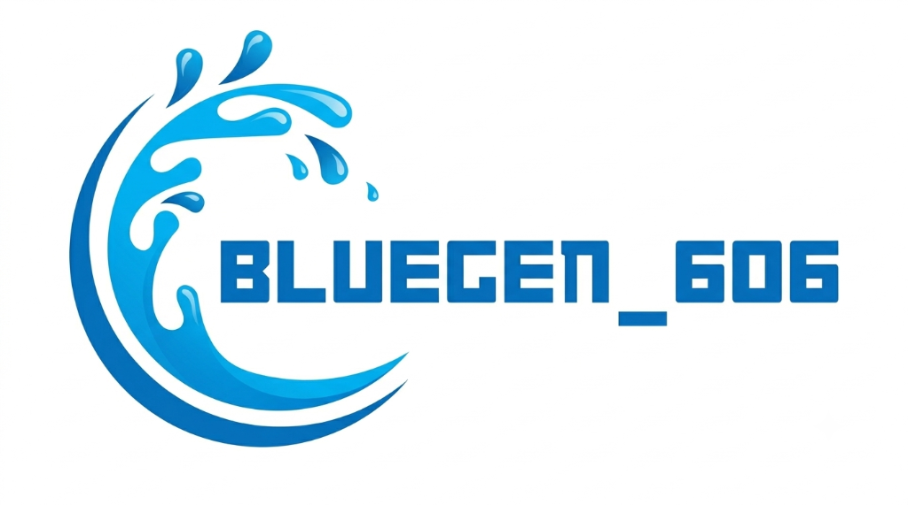
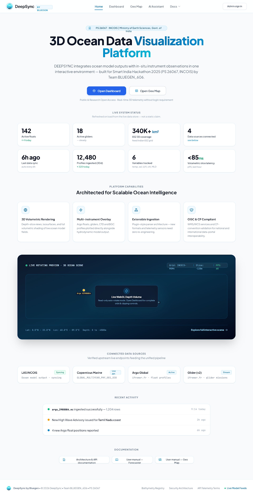
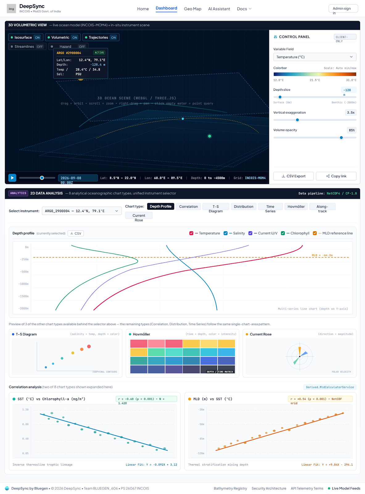
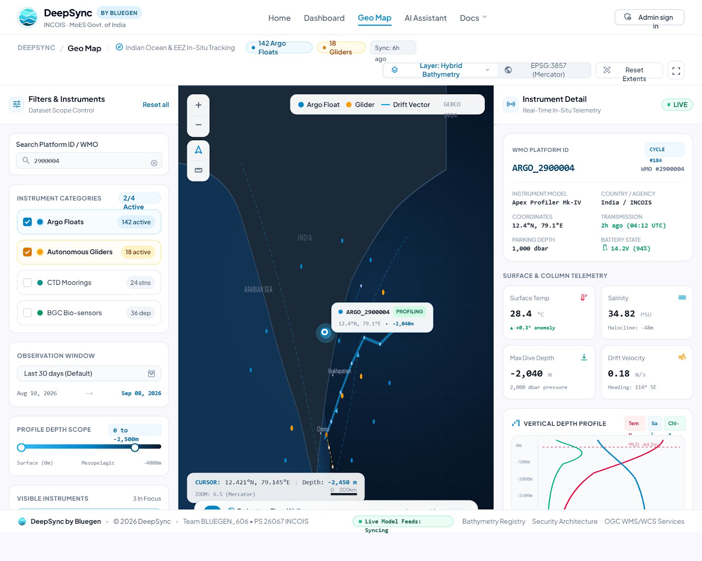
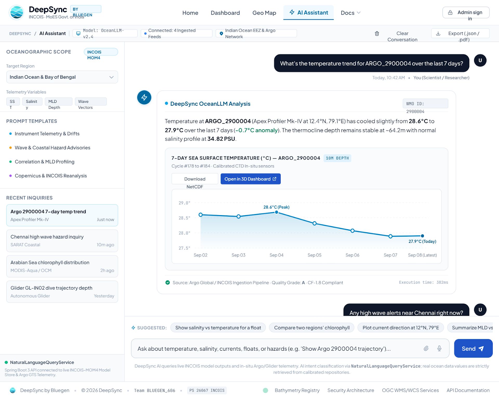
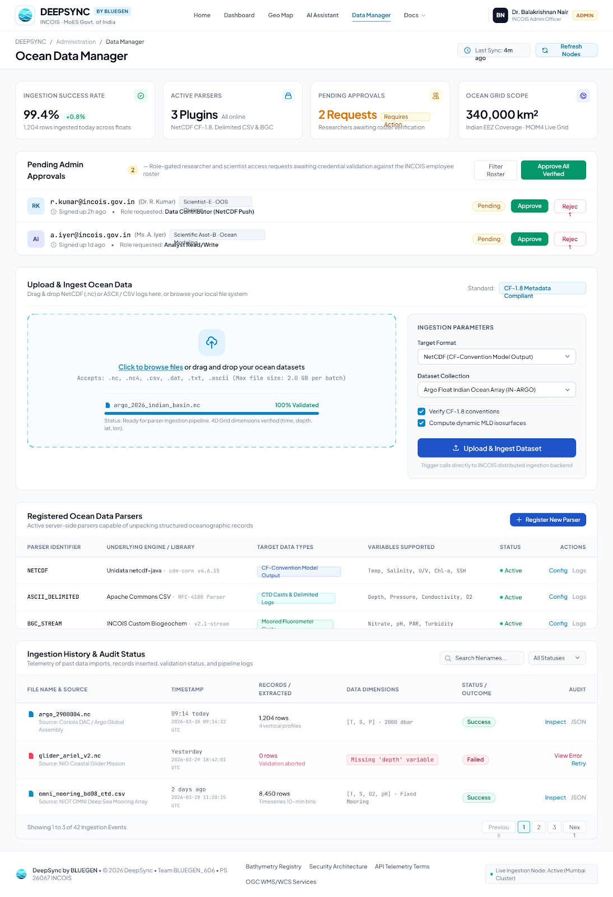
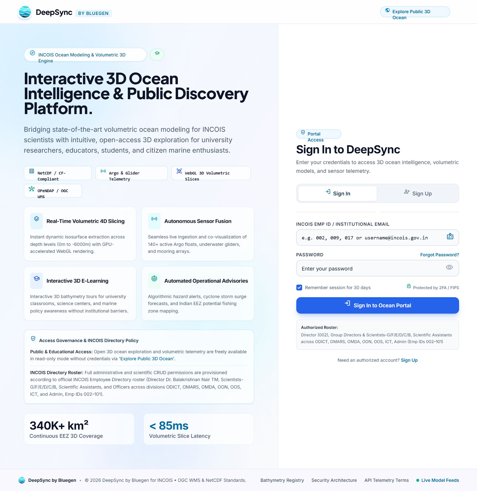

<p align="center">
  
</p>

<h1 align="center">DEEPSYNC</h1>
<h3 align="center">3D Ocean Data Visualization & Intelligence Platform</h3>

<p align="center">
  <em>Synchronizing depth, location, time, and observational data sources for ocean science</em>
</p>

<p align="center">
  
  
  
  
  
  
  
  
</p>

<p align="center">
  <strong>Team BLUEGEN_606</strong> | SEVA First Innovation Challenge 2026 | Theme: Swachh & Sustainable Bharat<br/>
  Problem Statement: PS 26067 | INCOIS, Ministry of Earth Sciences, Government of India
</p>

---

## Executive Summary

DEEPSYNC is a modular, browser-based Ocean Data Visualization and Intelligence Platform developed by Team BLUEGEN_606 for the SEVA First Innovation Challenge 2026 under the Swachh & Sustainable Bharat theme. It unifies numerical ocean model outputs (INCOIS-MOM4, Copernicus Marine) with in-situ observational datasets (Argo profiling floats, autonomous underwater gliders, CTD casts, and biogeochemical sensors) within a high-performance 3D WebGL environment.

By combining depth-resolved volumetric rendering, multi-parameter spatial queries, CF-1.8 standardized ingestion, an AI query engine (OceanIQ), and operational hazard monitoring into one platform, DEEPSYNC bridges the gap between raw multidimensional scientific data and actionable ocean intelligence.

### The Core Problem

Researchers and operational forecasters currently navigate fragmented desktop applications, static 2D planar maps, and decoupled observational archives. This fragmentation impedes:
- Cross-validation of numerical model forecasts against physical in-situ measurements at identical spatio-temporal coordinates.
- Depth-resolved inspection across the entire water column (surface to -6000 m).
- Interactive navigation through dynamic time steps and volumetric isopycnal layers.
- Real-time synthesis of coastal hazards, biogeochemical indicators, and marine ecosystem parameters.

### The DEEPSYNC Solution

DEEPSYNC acts as an integration and intelligent visualization layer connecting numerical representations of the ocean with observational evidence in a single browser-native interface:

```
Location -> 3D Ocean State -> Depth Slicing -> Temporal Playback -> In-Situ Observation -> Natural Language Query -> Actionable Insight
```

---

## Visual Interface & Platform Modules

<details open>
<summary><strong>Home -- Live System Dashboard & Overview</strong></summary>
<br/>
<p align="center">
  
</p>
<p align="center"><em>Interactive overview featuring live telemetry metrics, connected data sources (INCOIS, CMEMS, Argo Global, Glider), and recent ingestion activity.</em></p>
</details>

<details open>
<summary><strong>Dashboard -- 3D Volumetric Engine & 2D Oceanographic Diagnostics</strong></summary>
<br/>
<p align="center">
  
</p>
<p align="center"><em>Interactive 3D WebGL volumetric scene with isosurface extraction, horizontal depth slicers, vertical exaggeration slider, Argo float marker overlays, and 8 integrated 2D analytical charts.</em></p>
</details>

<details open>
<summary><strong>GeoMap -- In-Situ Ocean Instrument Tracking</strong></summary>
<br/>
<p align="center">
  
</p>
<p align="center"><em>Real-time geospatial tracking of Argo floats, gliders, CTD moorings, and BGC bio-sensors over GEBCO bathymetry, with complete trajectory inspection and sounding profiles.</em></p>
</details>

<details open>
<summary><strong>OceanIQ -- AI Natural Language Query Assistant</strong></summary>
<br/>
<p align="center">
  
</p>
<p align="center"><em>Natural-language oceanographic assistant converting plain-English scientific inquiries into structured read-only queries with embedded diagnostic charts and CF-compliant metadata.</em></p>
</details>

<details>
<summary><strong>Data Manager & Administrative Ingestion Suite</strong></summary>
<br/>
<p align="center">
  
  
</p>
<p align="center"><em>Administrative dataset upload portal with automatic CF validation, parser registry, and secure JWT-based authentication.</em></p>
</details>

---

## System Architecture

The DEEPSYNC platform is structured into six decoupled layers designed for resilience, scientific accuracy, and low-latency client rendering:

```
+-------------------------------------------------------------------------+
|                       LAYER 1: USER INTERFACE                           |
|   React 19 + Vite 8 | Three.js / React Three Fiber | Leaflet | Chart.js  |
|   Researcher Portal | 3D Ocean Explorer | OceanIQ Chat | Data Workspace |
+-------------------------------------------------------------------------+
                                     |
+-------------------------------------------------------------------------+
|                LAYER 2: APPLICATION & BACKEND SERVICES                  |
|   Spring Boot 4.1 | Spring Security (JWT) | REST API Gateway            |
|   Marine Ingestion Service | Metadata & Catalogue | OceanIQ Query Agent |
|   Visualization Data Service | Comparative Analysis | Hazard Advisory   |
+-------------------------------------------------------------------------+
                                     |
+-------------------------------------------------------------------------+
|               LAYER 3: DATA PROCESSING & INTEROPERABILITY               |
|   Unidata NetCDF-Java (cdm-core) | Apache Commons CSV | PostGIS Filters |
|   Coordinate & Time Normalization | CF-1.8 Validation | OGC WMS/WCS     |
+-------------------------------------------------------------------------+
                                     |
+-------------------------------------------------------------------------+
|                         LAYER 4: DATA SOURCES                           |
|   Numerical Ocean Models (INCOIS-MOM4, IGORA, CMEMS)                    |
|   Observational Systems: Argo Core, BGC-Argo, Underwater Gliders, CTD   |
|   Environmental & Coastal Hazard Advisories (High Wave, SARAT)          |
+-------------------------------------------------------------------------+
                                     |
+-------------------------------------------------------------------------+
|                     LAYER 5: UNIFIED STORAGE LAYER                      |
|   PostgreSQL 16 (Relational Metadata & Grid Coordinates)                |
|   Flyway Database Migrations | NetCDF Repository | Structured Indices   |
+-------------------------------------------------------------------------+
                                     |
+-------------------------------------------------------------------------+
|                   LAYER 6: OUTPUTS & DECISION SUPPORT                   |
|   Interactive 3D Volumes | Multi-depth Stratification Profiles          |
|   Model-vs-Observation Skill Assessment | Coastal Hazard Intelligence   |
+-------------------------------------------------------------------------+
```

---

## Core Capabilities

### 1. Interactive 3D Visualization Engine
- **Volumetric Rendering**: Direct GPU-accelerated rendering of scalar and vector fields (temperature, salinity, chlorophyll, velocity vectors u/v).
- **Depth-Slice Navigation**: Spatial slicers allowing granular horizontal cutting planes from sea surface (0 m) to abyssal depths (-6000 m).
- **Isosurface Extraction**: Real-time thresholding to isolate thermoclines, haloclines, and pycnoclines.
- **Vertical Exaggeration**: Dynamically adjustable scaling (1.0x to 10.0x) to resolve thin stratified layers across vast horizontal domains.
- **Scientific Colorbars**: Colormap presets including Turbo, Viridis, Thermal, and Haline with automatic min/max range calibration.
- **4D Temporal Animation**: Interactive playback across temporal timesteps.

### 2. Quantitative 2D Oceanographic Diagnostics
Alongside 3D volumetric views, DEEPSYNC renders 8 synchronized oceanographic chart formats:

| Diagnostic Tool | Scientific Purpose |
|:---|:---|
| **Depth Profile** | Stratification curves displaying thermocline, halocline, and automated Mixed Layer Depth (MLD) reference lines. |
| **T-S Diagram** | Temperature versus salinity scatter plots with isopycnal potential density contours for water-mass identification. |
| **Hovmoller Diagram** | Spatio-temporal depth-versus-time matrix tracking seasonal subsurface evolution. |
| **Current Rose** | Polar velocity diagrams indicating directional frequency and current magnitude. |
| **Correlation Analysis** | Multi-variable regressions (e.g., SST vs Chlorophyll-a, MLD vs SST) with Pearson correlation coefficient and p-values. |
| **Frequency Distribution** | Value histograms across specified depth slices. |
| **Time Series** | Multi-depth temporal trends and anomaly tracking over selected time windows. |
| **Along-Track Transect** | Vertical section interpolations along moving glider trajectories or ship cruises. |

### 3. In-Situ Instrument Integration & Model Validation
- **Argo Profiling Floats**: Display active WMO floats, dive cycle counts, battery status, transmission timestamps, and recorded depth profiles.
- **Autonomous Gliders**: Track underwater dive trajectories and multi-sensor payloads (PAR, dissolved oxygen, backscatter, chlorophyll).
- **Model vs Observation Assessment**: Spatial co-location of numerical forecast grids and observational soundings, calculating local deviations, RMSE, and bias across forecast horizons.

### 4. OceanIQ: Grounded AI Natural Language Query Agent
- Natural-language interface powered by scientific intent classification.
- Converts plain-English queries into validated, read-only analytical queries against PostgreSQL and NetCDF stores.
- Grounded in active platform records -- calculates Mixed Layer Depth (MLD), queries coastal hazard advisories, and generates live inline charts.
- Example inquiries supported:
  - *"What is the temperature trend for ARGO_2900004 over the last 7 days?"*
  - *"Show the salinity variation with depth near 12.4 N, 79.1 E."*
  - *"Are there any active high wave alerts along the Tamil Nadu coast?"*

### 5. Extensible Ingestion & CF Standards Pipeline
- **NetCDF Ingestion Engine**: Built with Unidata NetCDF-Java/CDM (`cdm-core` 5.5.3) supporting NetCDF-3, NetCDF-4, and HDF5 conventions.
- **Delimited ASCII/CSV Parser**: Stream-based parsing via Apache Commons CSV with automated column mapping.
- **CF-1.8 Metadata Validation**: Automated verification of standard variable naming, dimensional consistency (`time`, `depth`/`level`, `latitude`, `longitude`), and coordinate reference systems.
- **Pluggable Architecture**: Implement the `OceanDataParser` interface to support new instrument telemetry formats without altering existing core logic.

---

## Technology Stack

| Domain | Technology | Version | Purpose |
|:---|:---|:---|:---|
| **Frontend Framework** | React | 19.2 | Component-driven user interface |
| **Build Tool** | Vite | 8.2 | Fast module bundling and development server |
| **3D Graphics** | Three.js / React Three Fiber / Drei | 0.185 / 9.7 / 10.7 | WebGL GPU-accelerated volumetric rendering |
| **Geospatial Mapping** | Leaflet / React-Leaflet | 1.9 / 4.2 | Interactive 2D maps and instrument tracking |
| **Data Visualization** | Chart.js / react-chartjs-2 | 4.5 / 5.3 | 2D oceanographic diagnostic charts |
| **State Management** | Zustand | 5.0 | Reactive global application state |
| **Styling** | Tailwind CSS | 3.4 | Responsive scientific interface design |
| **Backend Framework** | Spring Boot | 4.1 | Robust REST microservices architecture |
| **Language Runtime** | Java (OpenJDK) | 17 LTS | High-performance backend execution |
| **Persistence** | Spring Data JPA / Hibernate | 6.x | Object-relational mapping |
| **Relational Database** | PostgreSQL | 16 | Spatial coordinate and metadata storage |
| **Scientific Data Engine** | Unidata NetCDF-Java (`cdm-core`) | 5.5.3 | Direct NetCDF dimensional parsing |
| **Tabular Parser** | Apache Commons CSV | 1.10 | High-throughput ASCII profile ingestion |
| **Security & Auth** | Spring Security / BCrypt / JWT | Standard | Role-based access control and token authentication |
| **Containerization** | Docker / Docker Compose | 24+ | Multi-container environment orchestration |

---

## REST API Reference

The backend provides a comprehensive suite of REST endpoints:

### Ocean Grid & Volumetric Telemetry
| HTTP Method | Endpoint | Description |
|:---|:---|:---|
| `GET` | `/api/ocean/grid` | Query 3D grid points filtered by bounding box, depth slice, and timestamp |
| `GET` | `/api/ocean/profile` | Extract vertical depth profile at specified latitude and longitude |
| `GET` | `/api/ocean/variables` | List available scientific variables (temperature, salinity, currents, etc.) |
| `GET` | `/api/ocean/time-range` | Fetch available temporal bounding dates and distinct timesteps |
| `POST` | `/api/ocean/upload` | Upload NetCDF (`.nc`) or CSV files (supports uploads up to 200 MB) |

### In-Situ Platform Telemetry (Argo & Gliders)
| HTTP Method | Endpoint | Description |
|:---|:---|:---|
| `GET` | `/api/argo/floats` | List active instruments, platforms, and latest GPS coordinates |
| `GET` | `/api/argo/floats/{id}` | Detailed float metadata and trajectory history |
| `GET` | `/api/argo/floats/{id}/profiles` | Sounding samples with temperature, salinity, and pressure metrics |

### Environmental Intelligence & Hazards
| HTTP Method | Endpoint | Description |
|:---|:---|:---|
| `GET` | `/api/hazards` | Retrieve active operational hazard advisories (high wave, storm surge) |
| `POST` | `/api/hazards` | Publish a new coastal hazard advisory (admin role required) |
| `GET` | `/api/stats/summary` | Global dataset metrics, platform counts, and variable summaries |

### Ingestion & System Administration
| HTTP Method | Endpoint | Description |
|:---|:---|:---|
| `POST` | `/api/auth/login` | Authenticate user credentials and return JWT bearer token |
| `POST` | `/api/auth/register` | Register a new researcher or analyst account |
| `GET` | `/api/admin/parsers` | Inspect registered dataset parsers and supported file extensions |
| `GET` | `/api/datasets` | List ingested NetCDF datasets with CF validation logs |
| `GET` | `/api/health` | Service health status check |

---

## Project Structure

```
deepsync/
|-- assets/
|   `-- bluegen_606_logo.png           # Team BLUEGEN_606 primary emblem
|-- frontend/                          # Client-side React 19 application
|   |-- src/
|   |   |-- components/
|   |   |   |-- dashboard2d/           # Diagnostic charts (Profile, T-S, Hovmoller, etc.)
|   |   |   |-- dashboard3d/           # WebGL engine (OceanScene, DepthSlider, Slicers)
|   |   |   |-- datamanager/           # Dataset upload, CF validator, Ingestion logs
|   |   |   |-- geomap/                # Leaflet map, float trajectories, telemetry panel
|   |   |   |-- home/                  # Landing page and navigation
|   |   |   `-- shared/                # Layout shell, protected route guards
|   |   |-- store/                     # Zustand stores (useAppStore, useAuthStore)
|   |   |-- views/                     # Route pages (Dashboard, GeoMap, AiAssistant, etc.)
|   |   `-- utils/                     # Color maps and volumetric shader helpers
|   |-- package.json
|   `-- vite.config.js
|
|-- src/main/java/com/bluegen/deepsyncapp/
|   |-- DeepsyncAppApplication.java    # Spring Boot entry point (forced UTC timezone)
|   |-- config/                        # Database initializers and data seeders
|   |-- controller/                    # REST API Controllers
|   |-- dto/                           # Data Transfer Objects
|   |-- entity/                        # Hibernate / JPA Database Entities
|   |-- ingestion/                     # Ingestion pipeline and CF-1.8 validators
|   |-- model/                         # Domain models, filter specs, and DTOs
|   |-- netcdf/                        # Unidata CDM reader services
|   |-- repository/                    # Spring Data JPA repositories
|   `-- service/                       # Business logic, MLD computation, hazard services
|
|-- src/main/resources/
|   |-- application.properties         # Server port (8081), PostgreSQL datasource config
|   `-- db/migration/                  # Flyway database migration scripts
|
|-- Frontend-stitch-new/               # Design specifications and UI reference captures
|-- docker-compose.yml                 # PostgreSQL 16 container definition
|-- pom.xml                            # Maven dependencies and build setup
`-- run-app.bat                        # Rapid Windows local launch script
```

---

## Getting Started

### Prerequisites

Ensure the following tools are installed on your environment:
- **Java Development Kit (JDK) 17+**
- **Node.js 18+** and **npm**
- **Docker** and **Docker Compose**
- **Git**

### Installation & Execution

#### Step 1: Clone the Repository
```bash
git clone https://github.com/Kishore-dev-21/deepsync.git
cd deepsync
```

#### Step 2: Initialize the Database
Start the dedicated PostgreSQL 16 container:
```bash
docker compose up -d
```
The database will be exposed on port `5433` (configured to avoid standard PostgreSQL port conflicts).

#### Step 3: Run the Backend Service
Execute the Spring Boot service using the included Maven wrapper:

**Linux / macOS:**
```bash
./mvnw spring-boot:run
```

**Windows (PowerShell or CMD):**
```bash
.\mvnw.cmd spring-boot:run
```
The REST API will start and bind to `http://localhost:8081`. Default administrative credentials will be automatically initialized (`admin@deepsync.local` / `ChangeMe123!`).

#### Step 4: Run the Frontend Client
In a separate terminal, start the Vite development server:
```bash
cd frontend
npm install
npm run dev
```
Open your browser and navigate to `http://localhost:5173`.

---

## Data Foundation & Coverage

DEEPSYNC is specifically calibrated around the Indian Ocean region:
- **Spatial Bounds**: 60 E to 100 E Longitude | 0 N to 25 N Latitude
- **Vertical Scope**: Surface (0 m) down to abyssal soundings (-6000 m)
- **Time Window**: 2022 to 2023 baseline validation epoch with real-time observation feeds

### Integrated Datasets

| Source | Content & Variables | Format & Protocol |
|:---|:---|:---|
| **INCOIS-MOM4 / IGORA** | Temperature, Salinity, U/V Current Vectors, SSH | NetCDF-4 / CF-1.8 |
| **Copernicus Marine (CMEMS)** | Global Multi-Year Reanalysis Physics | NetCDF / OPeNDAP |
| **Argo Core Floats** | Pressure, Temperature, Salinity, Quality-Controlled Flags | NetCDF / WMO GTS Format |
| **BGC-Argo** | Dissolved Oxygen, Chlorophyll-a, BBP700, Nitrate, In-situ pH | NetCDF Bio-Argo |
| **Autonomous Gliders** | High-resolution vertical soundings and dive transects | NetCDF / CSV Trajectory |
| **CTD Casts** | High-precision conductivity, temperature, and depth profiles | WOCE ASCII / SeaBird Data |

---

## Security & Data Governance

- **Role-Based Access Control**: Differentiated roles for Public Viewers, Research Scientists, and Platform Administrators secured via JSON Web Tokens.
- **Read-Only AI Safeguards**: The Scientific Query Validation service enforces strict read-only execution on all natural-language generated queries.
- **Data Provenance**: Every ingested dataset maintains a complete tracking history, including checksum, source institution, ingestion timestamp, and CF compliance scores.
- **UTC Time Enforcement**: The backend enforces JVM-level UTC time synchronization to eliminate timezone discrepancies in ocean observation timestamps.

---

## Roadmap

| Phase | Milestone | Scope | Status |
|:---|:---|:---|:---|
| **Phase 1** | Ingestion & Core Services | NetCDF CF-1.8 ingestion, PostgreSQL data foundation, REST API | Completed |
| **Phase 2** | 3D Volumetric Visualization | WebGL 3D ocean scene, depth slicers, isosurface rendering, 8 2D charts | Completed |
| **Phase 3** | In-Situ Geospatial Tracking | GeoMap Leaflet engine, Argo float and glider telemetry tracking | Completed |
| **Phase 4** | OceanIQ AI Engine | Grounded natural language query agent, MLD calculation, hazard alerts | Completed |
| **Phase 5** | Sensor Expansion | High-Frequency (HF) Radar surface currents, ADCP acoustic profiling | Planned |
| **Phase 6** | Ecological Intelligence | Environmental DNA (eDNA) integration, potential fishing zones (PFZ) | Planned |

---

## Contributing

Contributions are welcome from oceanographers, data scientists, and developers.

1. Fork the repository
2. Create your feature branch: `git checkout -b feature/NewOceanDiagnostic`
3. Commit your modifications: `git commit -m 'Add new ocean diagnostic capability'`
4. Push to your branch: `git push origin feature/NewOceanDiagnostic`
5. Open a Pull Request for review

---

## Acknowledgments & Credits

- **Challenge**: SEVA First Innovation Challenge 2026
- **Theme**: Swachh & Sustainable Bharat
- **Problem Statement**: PS 26067
- **Nodal Agency**: Indian National Centre for Ocean Information Services (INCOIS), Ministry of Earth Sciences, Government of India
- **Developed by**: Team BLUEGEN_606

---

<p align="center">
  
  <br/>
  <strong>Team BLUEGEN_606</strong><br/>
  <em>Ocean Data Comes Alive in 3D</em><br/>
  <sub>SEVA First Innovation Challenge 2026</sub>
</p>
