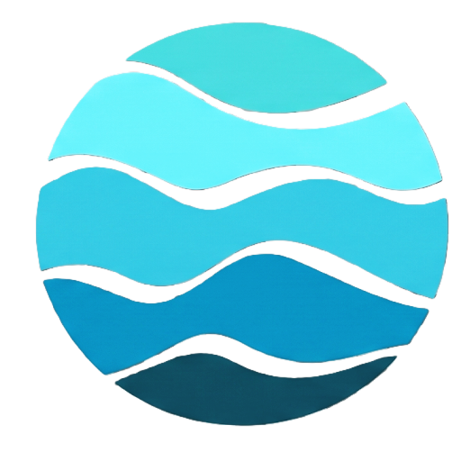

<p align="center">
  
</p>

<h1 align="center">🌊 DEEPSYNC</h1>
<h3 align="center">3D Ocean Data Visualization & Intelligence Platform</h3>

<p align="center">
  <em>Synchronizing depth, location, time & data sources for ocean science</em>
</p>

<p align="center">
  
  
  
  
  
  
  
  
</p>

<p align="center">
  <strong>Team BLUEGEN_606</strong> · SEVA First Innovation Challenge 2026 · PS 26067 · INCOIS, MoES Govt. of India
</p>

---

## 📖 About

**DEEPSYNC** is a unified, browser-native platform that integrates heterogeneous oceanographic datasets — numerical model outputs (INCOIS-MOM4, Copernicus Marine) and in-situ observations (Argo floats, autonomous gliders, CTD moorings) — into one interactive **3D volumetric visualization** environment with **depth-resolved exploration**, **AI-powered natural language queries**, and **real-time hazard monitoring**.

> India's coastline and Exclusive Economic Zone support livelihoods, fisheries, and coastal communities. DEEPSYNC turns complex ocean-state information into actionable scientific insight — supporting the **Swachh & Sustainable Bharat** initiative through evidence-based environmental monitoring.

### 🔑 The Problem

Researchers currently juggle fragmented desktop applications, flat 2D maps, and separate observational datasets — making it nearly impossible to correlate model predictions with real measurements at the same location and depth. **No browser-native 3D environment** renders model fields and in-situ observations together.

### ✅ The Solution

DEEPSYNC provides a **single geographic, vertical, and temporal context** where a user starts from a simple coordinate and progressively investigates the full multidimensional ocean state — from surface to benthic, across time, with models and observations side by side.

---

## 🖼️ Screenshots

<details>
<summary><strong>🏠 Home — Live System Dashboard</strong></summary>
<br/>
<p align="center">
  
</p>
<p align="center"><em>Live rotating 3D preview, real-time system metrics (142 Argo floats, 18 gliders, 340K+ km² coverage), connected data sources & recent activity feed</em></p>
</details>

<details>
<summary><strong>📊 Dashboard — 3D Volumetric Engine + 2D Analytics</strong></summary>
<br/>
<p align="center">
  
</p>
<p align="center"><em>Interactive WebGL 3D ocean scene with isosurfaces, volumetric rendering, depth slicing, Argo float overlays, and 8 analytical chart types (depth profile, T-S diagram, Hovmöller, current rose, correlation analysis & more)</em></p>
</details>

<details>
<summary><strong>🗺️ Geo Map — In-Situ Instrument Tracking</strong></summary>
<br/>
<p align="center">
  
</p>
<p align="center"><em>Real-time Leaflet map with Argo floats, gliders, CTD moorings & BGC bio-sensors. Instrument detail panel with live telemetry — surface temp, salinity, max dive depth, drift velocity & vertical depth profiles</em></p>
</details>

<details>
<summary><strong>🤖 AI Assistant — OceanIQ Natural Language Queries</strong></summary>
<br/>
<p align="center">
  
</p>
<p align="center"><em>Ask questions in plain English — "What's the temperature trend for ARGO_2900004 over the last 7 days?" — and get scientifically grounded answers with live charts, CF-1.8 quality metadata & one-click 3D dashboard links</em></p>
</details>

<details>
<summary><strong>📦 Data Manager & 🔐 Authentication</strong></summary>
<br/>
<p align="center">
  
  
</p>
<p align="center"><em>Admin data ingestion panel (NetCDF/CSV upload, parser registry, ingestion logs) and secure authentication</em></p>
</details>

---

## 🏗️ System Architecture

```
┌─────────────────────────────────────────────────────────────────────┐
│                    LAYER 1: USER INTERFACE                         │
│  React 19 + Vite 8 │ Three.js/R3F │ Chart.js │ Leaflet │ Tailwind │
├─────────────────────────────────────────────────────────────────────┤
│              LAYER 2: APPLICATION & BACKEND SERVICES               │
│        Spring Boot 4.1 │ REST API │ JWT Auth │ Spring Security     │
├─────────────────────────────────────────────────────────────────────┤
│            LAYER 3: DATA PROCESSING & COMMUNICATION                │
│    NetCDF-Java/CDM │ Apache CSV │ CF-1.8 Validation │ OGC/OPeNDAP │
├─────────────────────────────────────────────────────────────────────┤
│                    LAYER 4: DATA SOURCES                           │
│  INCOIS-MOM4 │ Copernicus Marine │ Argo Global │ Glider (ifremer)  │
├─────────────────────────────────────────────────────────────────────┤
│              LAYER 5: UNIFIED DATA & STORAGE                       │
│     PostgreSQL 16 │ Hibernate/JPA │ Flyway Migrations │ Docker     │
├─────────────────────────────────────────────────────────────────────┤
│            LAYER 6: OUTPUTS & DECISION SUPPORT                     │
│  3D Viz │ Depth Profiles │ Model-vs-Obs │ Hazard Alerts │ Reports  │
└─────────────────────────────────────────────────────────────────────┘
```

---

## ✨ Key Features

### 🌐 3D Volumetric Visualization Engine
- **Isosurface rendering** — extract surfaces of constant temperature, salinity, or chlorophyll
- **Volumetric shading** — full 3D opacity-mapped ocean data fields with adjustable transparency
- **Depth slicing** — horizontal cutting planes from surface (0m) to benthic (-4500m)
- **Vertical exaggeration** — adjustable up to 10× for resolving thin ocean layers
- **Time animation** — step through model time steps with playback controls
- **Colorbar customization** — auto min/max scaling with scientific colormaps
- **Argo & Glider overlays** — clickable instrument points with live trajectory rendering

### 📈 2D Oceanographic Diagnostics (8 Chart Types)
| Chart Type | Description |
|:---|:---|
| **Depth Profile** | Multi-series line chart (temp, salinity, current, chlorophyll) with MLD reference |
| **T-S Diagram** | Salinity vs temperature with depth-colored isopycnal contours |
| **Hovmöller** | Depth × time matrix with color intensity |
| **Current Rose** | Polar velocity plot for direction + magnitude |
| **Correlation** | Scatter with linear fit, Pearson r and p-value |
| **Distribution** | Histogram of variable values at selected depth |
| **Time Series** | Temporal evolution of selected variables |
| **Along-Track** | Glider trajectory data plotted along distance |

### 🗺️ Geospatial Map (Leaflet)
- Real-time Argo float & glider tracking with WMO platform IDs
- Instrument detail panel: surface temp, salinity, max dive depth, drift velocity, battery state
- Filterable by instrument category, observation window & profile depth scope
- GEBCO bathymetry overlay, EPSG:3857 Mercator projection
- Cursor coordinate & depth readout

### 🤖 OceanIQ — AI Natural Language Query Engine
- Ask questions in plain English: *"What is the salinity at 500m depth?"*
- AI intent classification → structured scientific query → validated execution
- Grounded in platform data — calculates MLD, identifies water masses, reports hazards
- Results as live charts + 3D scene snapshots with CF-1.8 quality metadata
- Suggested follow-up prompts for exploration

### 🛡️ Hazard Monitoring & Environmental Intelligence
- Coastal hazard advisories (high wave alerts, storm surge)
- Water quality indicators and biodiversity context
- Environmental monitoring supporting Swachh & Sustainable Bharat
- Region-based hazard information with scientific context

### 🔌 Extensible Data Ingestion
- **NetCDF parser** — Unidata NetCDF-Java/CDM (cdm-core 5.5.3) for NetCDF-3/4 files
- **ASCII/CSV parser** — Apache Commons CSV for delimited text observations
- **CF-1.8 validation** — metadata standardization ensuring source-independent interoperability
- **Plugin-style architecture** — add new formats without rebuilding the application
- **Profile auto-linking** — soundings automatically linked to platform IDs & spatial indexes

---

## 🛠️ Tech Stack

| Layer | Technology | Version |
|:---|:---|:---|
| **Frontend** | React, Vite, Tailwind CSS | 19, 8, 3.4 |
| **3D Engine** | Three.js, React Three Fiber, Drei | 0.185, 9.7, 10.7 |
| **Charts** | Chart.js, react-chartjs-2 | 4.5, 5.3 |
| **Maps** | Leaflet, React-Leaflet | 1.9, 4.2 |
| **State** | Zustand | 5.0 |
| **HTTP** | Axios | 1.20 |
| **Backend** | Spring Boot, Java | 4.1, 17 |
| **ORM** | Hibernate/JPA | via Spring Boot |
| **Database** | PostgreSQL | 16 |
| **Migrations** | Flyway | via Spring Boot |
| **NetCDF** | Unidata cdm-core | 5.5.3 |
| **CSV** | Apache Commons CSV | 1.10 |
| **Security** | Spring Security Crypto, JWT | via Spring Boot |
| **Testing** | JUnit 5, Testcontainers | via Spring Boot |
| **Containerization** | Docker Compose | Latest |

---

## 🚀 Getting Started

### Prerequisites

- **Java 17+** (JDK)
- **Node.js 18+** & npm
- **Docker** & Docker Compose
- **Git**

### 1. Clone the Repository

```bash
git clone https://github.com/Kishore-dev-21/deepsync.git
cd deepsync
```

### 2. Start the Database

```bash
docker compose up -d
```

This spins up a PostgreSQL 16 instance on **port 5433** with database `deepsync`.

### 3. Start the Backend

```bash
# Linux/macOS
./mvnw spring-boot:run

# Windows
mvnw.cmd spring-boot:run
```

The Spring Boot API starts on **http://localhost:8081**.

### 4. Start the Frontend

```bash
cd frontend
npm install
npm run dev
```

The React app opens on **http://localhost:5173**.

---

## 📡 REST API Reference

| Method | Endpoint | Description |
|:---|:---|:---|
| `GET` | `/api/health` | Health check |
| `POST` | `/api/auth/register` | User registration |
| `POST` | `/api/auth/login` | User authentication (JWT) |
| `GET` | `/api/ocean/grid` | Fetch ocean grid data with filters |
| `GET` | `/api/ocean/profile` | Depth profile for lat/lon |
| `GET` | `/api/ocean/variables` | Available scientific variables |
| `GET` | `/api/ocean/time-range` | Available time steps |
| `POST` | `/api/ocean/upload` | Upload NetCDF/CSV dataset (≤200MB) |
| `GET` | `/api/argo/floats` | List all Argo floats |
| `GET` | `/api/argo/floats/{id}` | Float details + positions |
| `GET` | `/api/argo/floats/{id}/profiles` | Depth profiles for a float |
| `GET` | `/api/hazards` | Active hazard advisories |
| `POST` | `/api/hazards` | Create hazard advisory (admin) |
| `GET` | `/api/stats/summary` | Variable statistics & summaries |
| `GET` | `/api/datasets` | List ingested datasets |
| `GET` | `/api/admin/parsers` | Available data parsers |

---

## 🗂️ Project Structure

```
deepsync/
├── frontend/                          # React + Vite frontend
│   ├── src/
│   │   ├── components/
│   │   │   ├── dashboard2d/           # 8 chart types (Profile, T-S, Hovmöller...)
│   │   │   ├── dashboard3d/           # 3D engine (OceanScene, ControlPanel, DepthSlider...)
│   │   │   ├── datamanager/           # Upload, parser registry, ingestion logs
│   │   │   ├── geomap/                # MapCanvas, GlobeCanvas, InstrumentDetail
│   │   │   ├── home/                  # Navbar
│   │   │   └── shared/                # Layout, ProtectedRoute
│   │   ├── views/                     # Page components (Home, Dashboard, GeoMap, AI...)
│   │   ├── store/                     # Zustand stores (app state, auth)
│   │   └── utils/                     # Volume renderer utilities
│   └── package.json
│
├── src/main/java/com/bluegen/deepsyncapp/
│   ├── controller/                    # REST controllers
│   │   ├── OceanDataController.java   # Core ocean data endpoints
│   │   ├── ArgoController.java        # Argo float operations
│   │   ├── HazardAdvisoryController.java
│   │   ├── AuthController.java        # JWT authentication
│   │   ├── StatsController.java       # Statistical summaries
│   │   ├── DatasetController.java     # Dataset management
│   │   └── AdminParserController.java # Parser administration
│   ├── entity/                        # JPA entities
│   │   ├── OceanGridPointEntity.java  # Lat/lon/depth/time grid points
│   │   ├── ArgoFloatEntity.java       # Argo float metadata
│   │   ├── FloatPositionEntity.java   # Float trajectory positions
│   │   ├── ProfileSampleEntity.java   # Depth profile measurements
│   │   ├── HazardAdvisoryEntity.java  # Coastal hazard alerts
│   │   ├── UserEntity.java           # User accounts
│   │   ├── ChatMessageEntity.java     # AI conversation history
│   │   └── IngestionEntity.java       # Dataset ingestion tracking
│   ├── ingestion/                     # Data parsers
│   │   ├── OceanDataParser.java       # Parser interface
│   │   ├── NetCdfOceanDataParser.java # NetCDF-3/4 parser
│   │   ├── AsciiOceanDataParser.java  # CSV/text parser
│   │   └── NetCdfDatasetLoader.java   # Dataset metadata extractor
│   ├── netcdf/
│   │   └── NetcdfReaderService.java   # Low-level NetCDF reader
│   ├── service/                       # Business logic
│   ├── repository/                    # JPA repositories
│   ├── model/                         # DTOs & value objects
│   └── dto/                           # Request/response DTOs
│
├── src/main/resources/
│   ├── application.properties         # Spring Boot config (port 8081)
│   └── db/migration/                  # Flyway SQL migrations
│
├── src/test/                          # Unit & integration tests
├── docker-compose.yml                 # PostgreSQL 16 container
├── pom.xml                            # Maven dependencies
└── Frontend-stitch-new/               # UI design reference & screenshots
```

---

## 🌍 Data Coverage

| Dataset | Source | Region | Variables |
|:---|:---|:---|:---|
| **INCOIS-MOM4** | INCOIS, MoES | Indian Ocean (60°E–100°E, 0°N–25°N) | Temperature, Salinity, Currents |
| **Copernicus Marine** | CMEMS (GLOBAL_MULTIYEAR_PHY) | Global / Indian Ocean | Temperature, Salinity, SSH |
| **Argo Global** | ifremer.fr | Indian Ocean EEZ | T/S profiles, float trajectories |
| **Glider (v2)** | ifremer.fr | Indian Ocean | Dive profiles, missions |

All data standardized via **CF Conventions (CF-1.8)** with OGC WMS/WCS and OPeNDAP interoperability.

---

## 🔐 Security

- **JWT Authentication** with Spring Security
- **Role-based access control** (admin/user)
- **Scientific Query Validation** — AI-generated queries checked and kept read-only
- **Secure service-to-service** communication
- **CF-compliant validation** with quality checks before data exposure
- **Environment-variable overrides** for production credentials

---

## 🗺️ Roadmap

| Phase | Focus | Status |
|:---|:---|:---|
| **Phase 1** | Core backend, ingestion pipeline, database schema | ✅ Complete |
| **Phase 2** | 3D visualization engine, 2D analytics dashboard | ✅ Complete |
| **Phase 3** | Geo Map, Argo/Glider integration, instrument telemetry | ✅ Complete |
| **Phase 4** | OceanIQ AI assistant, hazard monitoring | ✅ Complete |
| **Phase 5** | HF-radar, ADCP, BGC observations, eDNA integration | 🔜 Planned |
| **Phase 6** | ML-derived products, fisheries & biodiversity modules | 🔜 Planned |

---

## 👥 Target Users

| User | Use Case |
|:---|:---|
| 🔬 **Researchers** | Multi-dimensional ocean state analysis, model validation |
| 🌊 **Oceanographers** | Depth-resolved exploration, water mass identification |
| ⛈️ **Forecasters** | Model-vs-observation comparison, forecast skill assessment |
| 🏛️ **Decision Makers** | Environmental monitoring, evidence-based policy support |
| 🎓 **Educators** | Interactive ocean science demonstrations |

---

## 🤝 Contributing

Contributions are welcome! Please feel free to submit a Pull Request.

1. Fork the repository
2. Create your feature branch (`git checkout -b feature/AmazingFeature`)
3. Commit your changes (`git commit -m 'Add AmazingFeature'`)
4. Push to the branch (`git push origin feature/AmazingFeature`)
5. Open a Pull Request

---

## 📄 License

This project is developed by **Team BLUEGEN_606** for the **SEVA First Innovation Challenge 2026** (PS 26067, INCOIS — Ministry of Earth Sciences, Government of India).

---

<p align="center">
  
  <br/>
  <strong>DeepSync by Bluegen</strong>
  <br/>
  <em>From raw data to actionable ocean intelligence</em>
  <br/><br/>
  <sub>© 2026 DeepSync · Team BLUEGEN_606 · PS 26067 · INCOIS, MoES Govt. of India</sub>
</p>
